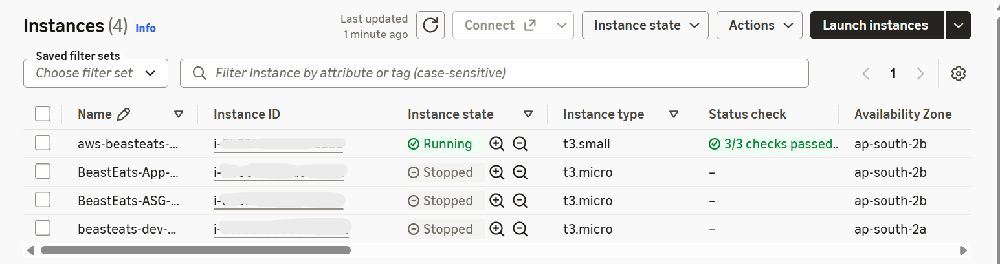
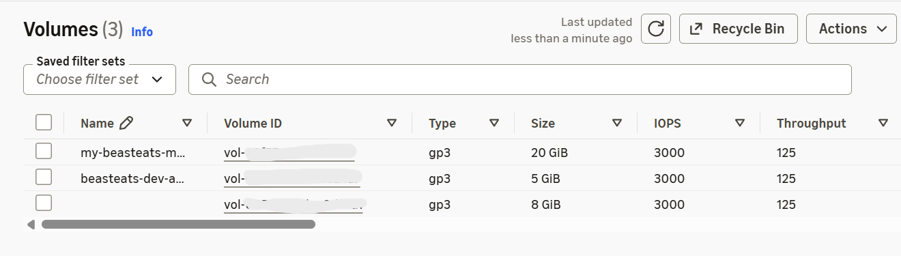
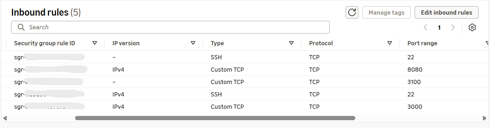
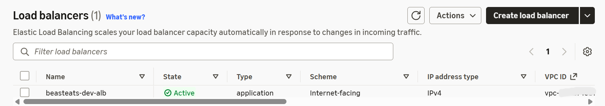
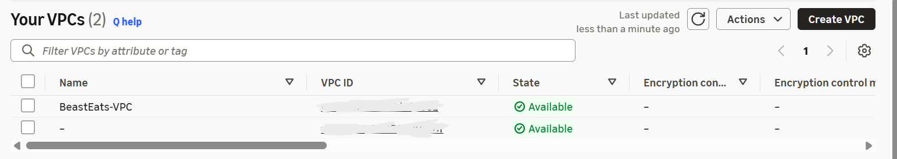
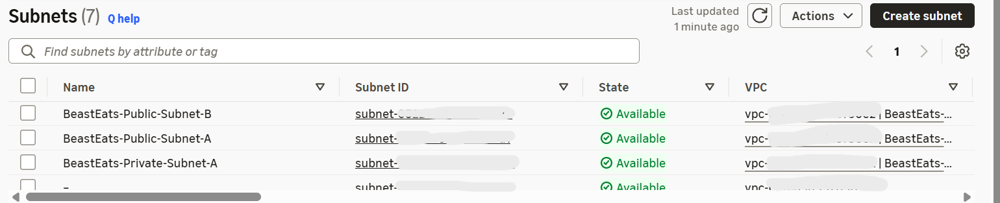

# AWS Cloud Infrastructure

This section documents my hands-on experience with AWS infrastructure provisioning, compute, storage, networking, security and load balancing through practical exercises using the AWS Management Console.

## 1. Amazon EC2 – Compute

- Launched and managed EC2 instances using different instance types.
- Practiced starting and stopping instances.
- Monitored instance states and status checks.
- Explored instance configuration across Availability Zones.

## 2. Amazon EBS – Block Storage

- Explored EBS volumes and their attachment to EC2 instances.
- Worked with General Purpose SSD (gp3) volumes.
- Reviewed volume capacity, IOPS and throughput configurations.
- Practiced volume management and storage operations.

## 3. AWS Security Groups

- Configured inbound traffic rules for EC2-related services.
- Explored SSH and custom TCP port access.
- Practiced controlling network access through security groups.

## 4. Application Load Balancer

- Created and explored an Application Load Balancer.
- Examined its internet-facing configuration and availability state.
- Practiced understanding how load balancing distributes application traffic.

## 5. Amazon VPC – Virtual Private Cloud

- Created and explored a dedicated VPC for the BeastEats environment.
- Examined VPC availability and network configuration.
- Practiced understanding AWS network isolation.

## 6. VPC Subnets

- Explored public and private subnet configurations.
- Organized subnets across Availability Zones.
- Practiced understanding subnet placement within a VPC.

---

## Key AWS Services Practiced

| Service | Hands-on Focus |
|---|---|
| Amazon EC2 | Virtual machine management |
| Amazon EBS | Block storage |
| AWS VPC | Network isolation |
| Subnets | Public and private networking |
| Security Groups | Inbound traffic control |
| Application Load Balancer | Application traffic distribution |

**Note:** This README documents selected practical exercises and configurations. It does not imply that all displayed AWS resources are currently running.