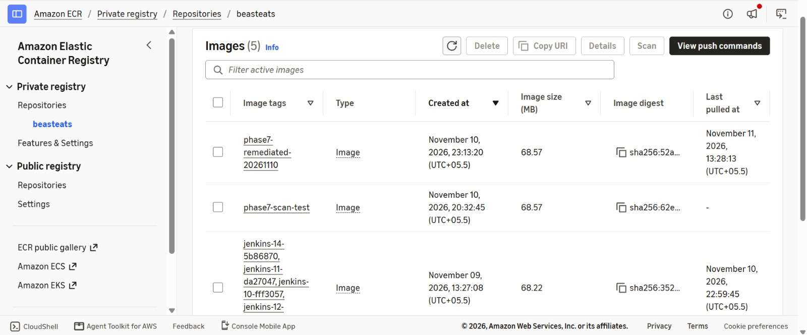
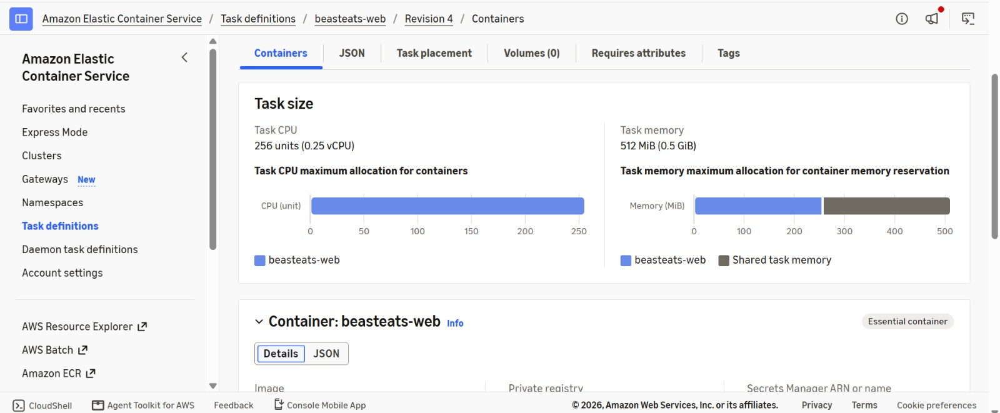
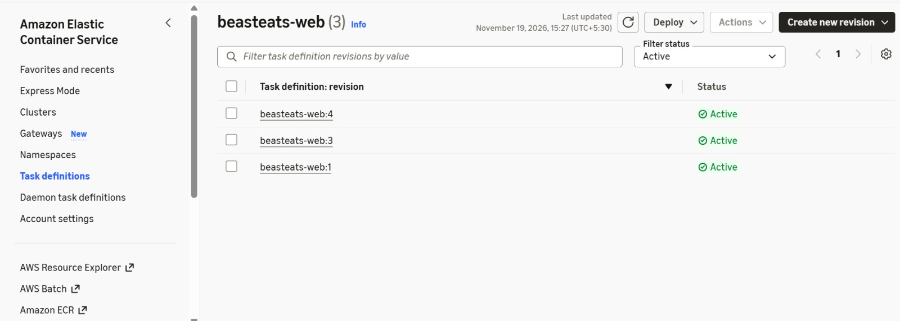
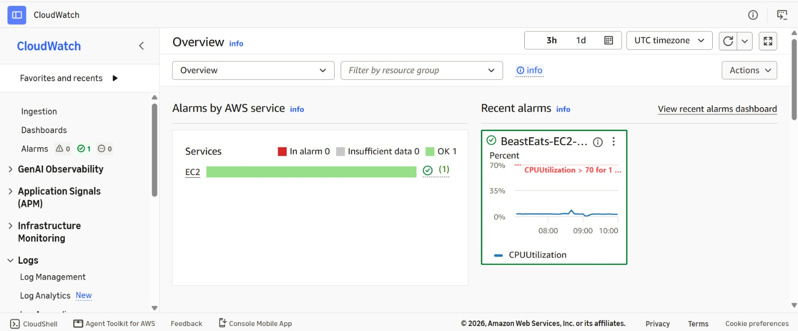
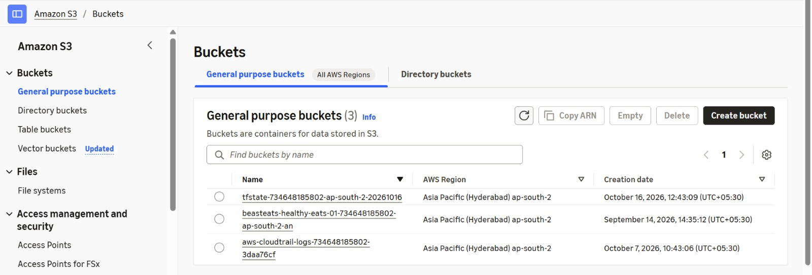
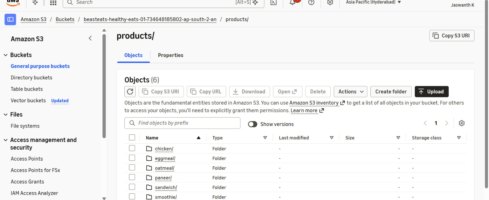

# BeastEats – Food Ordering Web Application

BeastEats is a fitness-focused food ordering web application built using Python and Flask. It features nutritious meals, food categories, nutritional information, pricing, and a shopping cart.

The project demonstrates practical implementation of application containerization, CI/CD automation, AWS cloud infrastructure, container orchestration, monitoring, and cloud-based application asset management.

## Application Screenshots

### 1. Homepage


### 2. Food Menu and Nutrition Information


### 3. Shopping Cart


## Technology Stack

| Category | Technologies |
|---|---|
| Application | Python, Flask |
| Containerization | Docker |
| Web Server | Gunicorn |
| Testing | Pytest, pytest-cov |
| Code Quality | SonarCloud |
| CI/CD Automation | Jenkins |
| Container Registry | Amazon ECR |
| Container Orchestration | Kubernetes, Amazon ECS |
| Package Management | Helm |
| Cloud Infrastructure | AWS EC2, Amazon VPC |
| Cloud Storage | Amazon S3, Amazon EBS |
| Monitoring | Amazon CloudWatch |
| Deployment Automation | AWS Systems Manager (SSM) |
| Infrastructure as Code | Terraform |

## CI/CD and Deployment Workflow

The project incorporates automated build, testing, code-quality analysis, container image management, and deployment workflows.

Key components include:

- Jenkins for CI/CD pipeline automation.
- Docker for application containerization.
- Pytest and pytest-cov for automated testing.
- SonarCloud for static code analysis and quality gate evaluation.
- Amazon ECR for Docker image storage and version management.
- AWS Systems Manager for EC2 deployment automation.
- Kubernetes and Helm for container orchestration and application configuration.

## AWS Infrastructure & Implementation

### 1. Amazon ECR – Container Image Management

BeastEats Docker images are stored in Amazon Elastic Container Registry (ECR).

The repository contains versioned application images generated during CI/CD pipeline executions, supporting image management and deployment workflows.



### 2. Amazon ECS – Container Orchestration

Amazon Elastic Container Service (ECS) task definitions were configured to define the container runtime requirements for BeastEats.

**Task Definition Configuration:**

- Task definition family: `beasteats-web`
- Container name: `beasteats-web`
- CPU allocation: 256 CPU units (0.25 vCPU)
- Memory allocation: 512 MiB
- Container image source: Amazon ECR



### 3. Amazon ECS – Task Definition Revisions

Multiple ECS task definition revisions were registered to manage changes in container configurations.

The documented revisions include:

- `beasteats-web:1`
- `beasteats-web:3`
- `beasteats-web:4`

These revisions demonstrate version management of ECS container configurations.



### 4. Amazon CloudWatch – Monitoring & Alerting

Amazon CloudWatch was used to monitor EC2 infrastructure metrics and configure CPU utilization alarms.

The monitoring configuration includes:

- EC2 CPU utilization monitoring.
- CPU utilization alarm threshold of 70%.
- Dashboard-based infrastructure monitoring.
- Visibility into alarm status and instance performance.



### 5. Amazon S3 – Cloud Storage

Amazon Simple Storage Service (S3) was used for application asset storage and supporting AWS infrastructure workflows.

The documented buckets include storage for:

- BeastEats application assets.
- Terraform state files.
- AWS CloudTrail logs.



### 6. Amazon S3 – Product Asset Organization

BeastEats product assets were organized into category-based folders within an S3 bucket.

**Product categories:**

- Chicken
- Egg Meal
- Oatmeal
- Paneer
- Sandwich
- Smoothie

This organization provides a structured approach to managing application product assets.



## Testing & Code Quality

The project incorporates automated testing and code-quality analysis.

- **Pytest:** Application testing.
- **pytest-cov:** Test coverage measurement.
- **SonarCloud:** Static code analysis and code-quality evaluation.
- **Quality Gates:** Code-quality checks integrated into the CI/CD workflow.

## Project Structure

```text
BeastEats-Project/
├── app/
├── assets/
│   ├── beasteats-homepage.png
│   ├── beasteats-menu.png
│   ├── beasteats-cart.png
│   └── aws/
│       ├── ecr-images.png
│       ├── ecs-task-definition.png
│       ├── ecs-task-revisions.png
│       ├── cloudwatch-dashboard.png
│       ├── s3-buckets.png
│       └── s3-product-assets.png
├── tests/
├── helm/
├── migrations/
├── Dockerfile
├── requirements.txt
├── seed.py
├── beasteats-app-deployment.yaml
├── beasteats-app-service.yaml
├── beasteats-app-pvc.yaml
└── README.md
```

## Run Locally Using Docker

### Prerequisites

- Docker installed and running.
- Application configuration and required environment variables.

### 1. Build the Docker Image

Run this command from the project root directory:

```bash
docker build -t beasteats:1.0.0 .
```

### 2. Run the Application

```bash
docker run -d --name beasteats-app -p 8000:8000 beasteats:1.0.0
```

### 3. Access the Application

Open the following URL in your browser:

http://localhost:8000

### 4. Stop the Container

```bash
docker stop beasteats-app
```

**Note:** Local execution may require application-specific environment variables, database configuration, and persistent storage setup. Configure the required dependencies before running the application.

## Project Highlights

- Developed a fitness-focused food ordering application using Python and Flask.
- Containerized the application using Docker and Gunicorn.
- Automated build, testing, and deployment workflows through Jenkins.
- Integrated Pytest and SonarCloud for automated testing and code-quality analysis.
- Managed versioned Docker images using Amazon ECR.
- Configured Amazon ECS task definitions and maintained multiple revisions.
- Implemented EC2 deployment automation using AWS Systems Manager.
- Created Kubernetes manifests and Helm charts for container orchestration.
- Configured persistent application storage.
- Used Amazon CloudWatch for EC2 monitoring and CPU utilization alarms.
- Organized application product assets using Amazon S3.
- Worked with Terraform state storage and AWS infrastructure resources.

---

**Project:** BeastEats
**Repository:** aws-devops-projects
**Focus:** AWS DevOps, CI/CD, Containerization, Cloud Infrastructure, and Monitoring