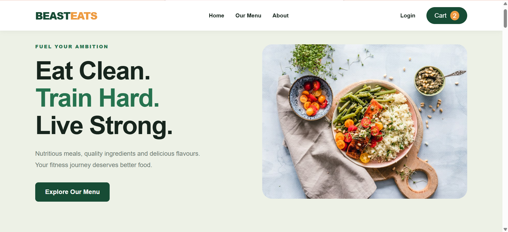
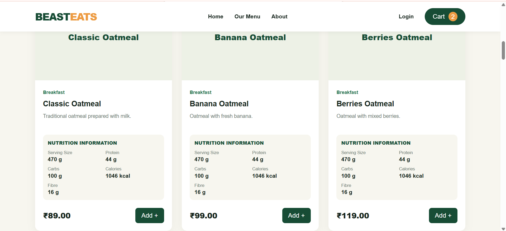
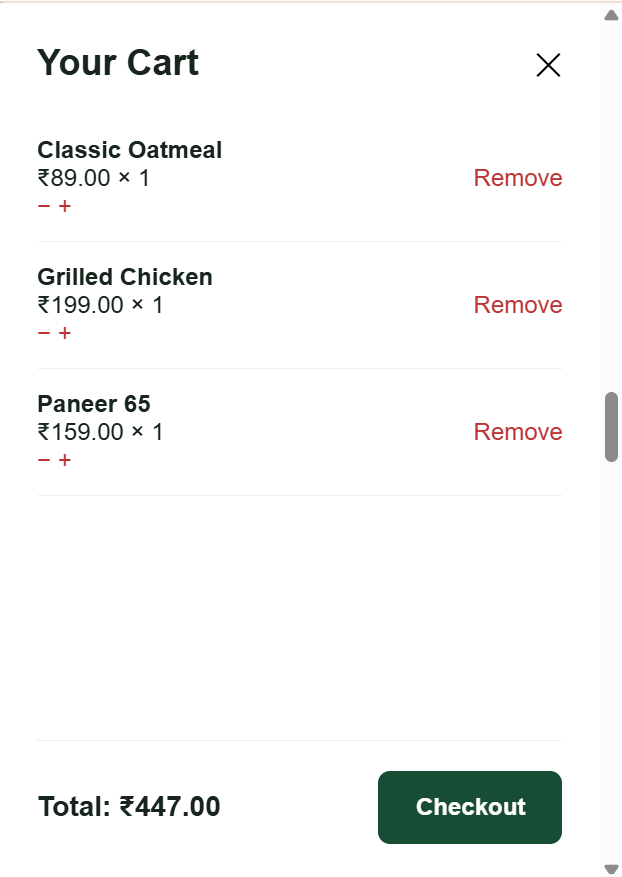

# BeastEats – Food Ordering Web Application

BeastEats is a fitness-focused food ordering web application featuring nutritious meals, food categories, nutritional information, pricing, and a shopping cart.

## Application Screenshots

### 1. Homepage



### 2. Food Menu and Nutrition Information



### 3. Shopping Cart



## Technology Stack

- **Application:** Python
- **Containerization:** Docker
- **Web Server:** Gunicorn
- **Testing:** Pytest and pytest-cov
- **Code Quality:** SonarCloud
- **Orchestration:** Kubernetes
- **Package Management:** Helm
- **Deployment Automation:** Jenkins
- **Infrastructure:** AWS

## Project Structure

```text
BeastEats-Project/
├── app/
├── assets/
├── tests/
├── helm/
├── migrations/
├── Dockerfile
├── requirements.txt
├── seed.py
├── beasteats-app-deployment.yaml
├── beasteats-app-service.yaml
├── beasteats-app-pvc.yaml
└── README.md
```

## Run Locally Using Docker

Build the Docker image:

```bash
docker build -t beasteats:1.0.0 .
```

Run the application:

```bash
docker run -d --name beasteats-app -p 8000:8000 beasteats:1.0.0
```

Open in your browser:

```text
http://localhost:8000
```

Stop the container:

```bash
docker stop beasteats-app
```

## Project Highlights

- Containerized application using Docker.
- Automated build and deployment through Jenkins.
- Application testing and code-quality analysis.
- AWS ECR image management.
- Deployment to AWS EC2 using AWS Systems Manager.
- Kubernetes manifests and Helm chart for orchestration.
- Persistent application storage configuration.

---

**Project:** BeastEats
**Repository:** aws-devops-projects
**Focus:** AWS DevOps, CI/CD and Containerization