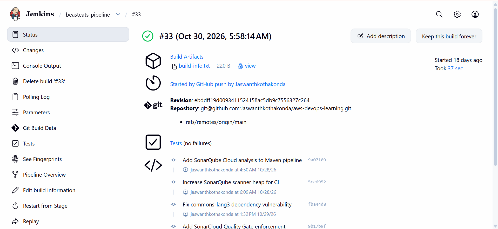
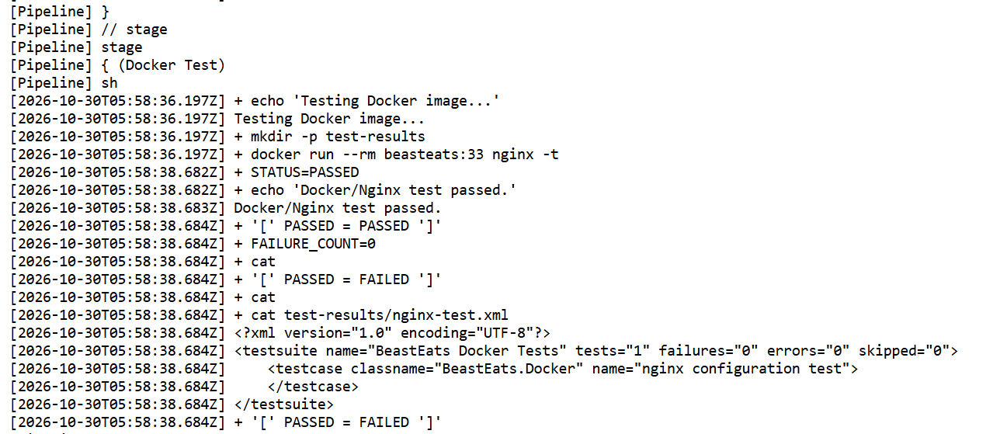
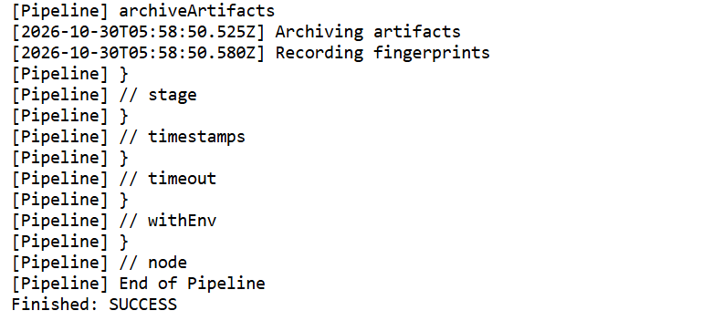

# CI/CD Automation

This section contains practical implementations of CI/CD pipeline automation, build management, automated testing, code quality analysis, and Linux administration.

## Repository Structure

```text
CI-CD-Automation/
├── Jenkinsfile
├── Maven/
│   ├── Jenkinsfile
│   ├── pom.xml
│   └── src/
├── Linux/
│   └── Bash scripts
├── assets/
│   ├── jenkins-build-summary.png
│   ├── docker-test-results.png
│   └── pipeline-success.png
└── README.md
```

## 1. Jenkins CI/CD Pipeline

**Pipeline:** BeastEats Pipeline

Developed a declarative Jenkins pipeline to automate application validation, containerization, testing, code quality analysis, and deployment workflows.

### Pipeline Implementations

- Integrated GitHub source code with Jenkins using SSH credentials.
- Automated workspace cleanup and source-code checkout.
- Generated build information and commit metadata.
- Integrated Ansible syntax and inventory validation.
- Validated application files and dependencies.
- Built Docker images using the application Dockerfile.
- Executed automated application tests using Pytest.
- Generated JUnit XML and code coverage reports.
- Integrated SonarCloud static code analysis.
- Enforced SonarCloud Quality Gate checks.
- Authenticated with Amazon ECR and published Docker images.
- Verified published container images.
- Included production deployment approval.
- Integrated AWS Systems Manager for EC2 deployment.
- Implemented application health checks and rollback handling.

### Pipeline Workflow

```text
GitHub
   |
   v
Jenkins Pipeline
   |
   +--> Workspace Cleanup
   |
   +--> Source Code Checkout
   |
   +--> Ansible Validation
   |
   +--> Application Validation
   |
   +--> Docker Image Build
   |
   +--> Pytest & Coverage
   |
   +--> Publish Test Reports
   |
   +--> SonarCloud Analysis
   |
   +--> Quality Gate
   |
   +--> Amazon ECR
   |
   +--> Image Verification
   |
   +--> Production Approval
   |
   +--> AWS Systems Manager
   |
   v
Amazon EC2 Deployment
```

### Jenkins Build Evidence

**Successful Jenkins Build**



**Docker Test Execution**



**Pipeline Completion**



*Screenshots show a historical successful pipeline execution from October 30, 2026.*

## 2. Maven Build Automation

**Directory:** `Maven/`

Created a standalone Java application using Apache Maven and JUnit 5.

Practical implementations:

- Organized Java source and test code using Maven conventions.
- Configured project dependencies in `pom.xml`.
- Practiced Maven build lifecycle commands.
- Executed automated unit tests.
- Integrated Maven build and testing into a Jenkins pipeline.
- Configured test report publishing and JAR artifact archiving.

**Build command:**

```bash
mvn clean verify
```

## 3. Linux & Bash Scripting

**Directory:** `Linux/`

Practiced Linux administration and Bash scripting through individual exercises.

Topics include:

- Variables and user input.
- Conditional statements.
- Loops and functions.
- Command-line arguments.
- File and directory validation.
- Error handling and safe scripting.
- Disk usage checks.
- Server health checks.
- Docker status checks.
- Git status checks.

## Technology Stack

| Category | Technologies |
|---|---|
| CI/CD | Jenkins |
| Version Control | Git, GitHub |
| Build Automation | Apache Maven |
| Programming | Java, Python |
| Scripting | Bash, Groovy |
| Code Quality | SonarCloud |
| Testing | Pytest, JUnit 5 |
| Containerization | Docker |
| Container Registry | Amazon ECR |
| Cloud Deployment | AWS EC2, AWS Systems Manager |
| Configuration Management | Ansible |
| Operating System | Linux |

## Learning Outcomes

- Designed declarative Jenkins pipelines.
- Integrated multiple tools into automated delivery workflows.
- Practiced automated testing and code quality enforcement.
- Managed Docker image build and publishing workflows.
- Integrated AWS services into application deployment automation.
- Practiced Maven build automation and Linux administration.