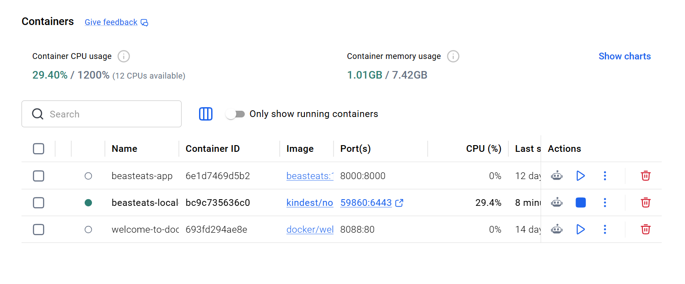
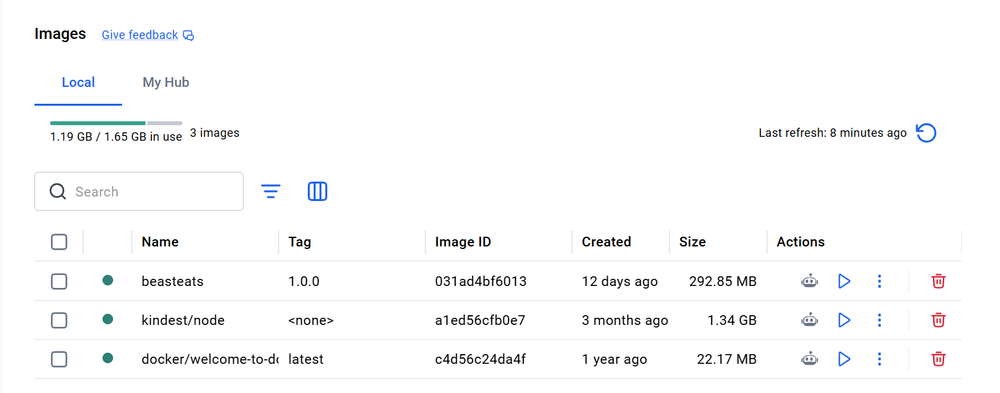
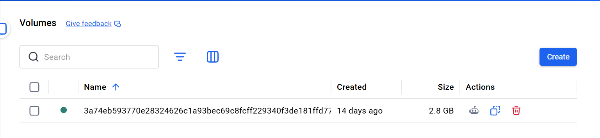
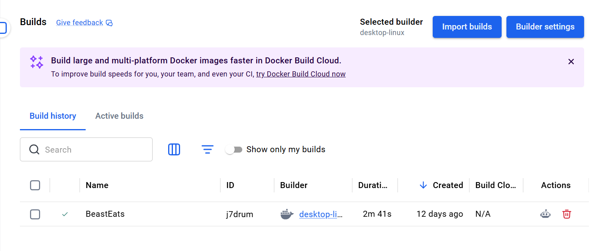
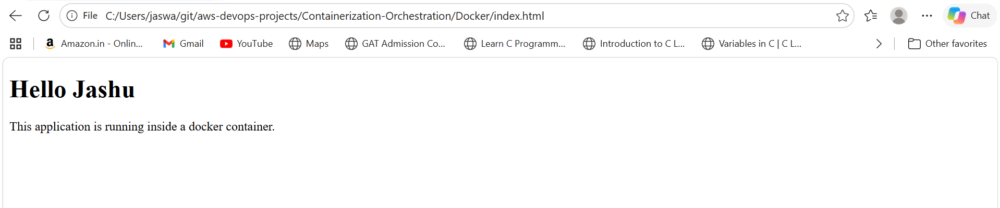

# Docker – Containerization Hands-on

This section documents my practical experience with Docker, including building custom images, running containers, managing persistent volumes, and using Docker Compose to deploy multi-container applications.

## 1. Technologies Used

- Docker
- Docker Desktop
- Amazon Linux 2023
- Nginx
- Docker Compose
- HTML

## 2. Repository Structure

```text
Docker/
├── assets/
│   ├── docker-builds.png
│   ├── docker-containers.png
│   ├── docker-images.png
│   ├── docker-volumes.png
│   └── docker-web-app.png
├── compose-demo/
│   └── compose.yaml
├── .dockerignore
├── Dockerfile
├── Dockerfile.security
├── compose.yaml
└── index.html
```

## 3. Docker Image Building

Created a custom Docker image using `amazonlinux:2023` as the base image.

- Installed Nginx inside the image.
- Configured the working directory.
- Copied a custom HTML page into the container.
- Exposed port 80.
- Configured Nginx to run in the foreground.

**Dockerfile:** `Dockerfile`

## 4. Container Management

Built and managed Docker containers through Docker Desktop.

- Created and ran the BeastEats Docker container.
- Inspected container status and port mappings.
- Monitored container CPU and memory usage.
- Practised starting and stopping containers.



## 5. Docker Images

Built and inspected Docker images locally.

- Created the custom `beasteats:1.0.0` image.
- Reviewed image tags, IDs, and sizes.
- Inspected locally available images.



## 6. Docker Volumes

Explored Docker volume management and persistent storage.

- Inspected Docker volumes.
- Reviewed volume size and available management actions.
- Practised understanding storage persistence beyond container lifecycle.



## 7. Docker Compose

Used Docker Compose to define and manage multiple services.

**Main Compose configuration:**
- Nginx web service mapped to host port `8080`.
- Amazon Linux application service.
- Environment variables for application configuration.

**Compose demo:**
- Configured service dependencies.
- Added a health check to the application service.
- Used `depends_on` with the `service_healthy` condition.

Files:
- `compose.yaml`
- `compose-demo/compose.yaml`

## 8. Docker Security – Non-Root Container

Created a separate security-focused Dockerfile.

- Used Amazon Linux 2023 as the base image.
- Installed the required user-management utility.
- Created a system user named `appuser`.
- Configured the container to run as the non-root user.

**Dockerfile:** `Dockerfile.security`

## 9. Docker Build Evidence



## 10. Running the Web Application

Created a simple HTML page and served it through the custom Nginx Docker image.

The application was accessed successfully through the browser using the local HTML file.



## 11. Key Learnings

- Writing Dockerfiles and building custom images.
- Running and managing containers.
- Understanding image tags and container port mappings.
- Managing Docker volumes.
- Defining multi-service applications using Docker Compose.
- Configuring service health checks and dependencies.
- Applying non-root user execution inside containers.

---

**Project:** AWS DevOps Learning Portfolio
**Repository:** `aws-devops-projects`
**Section:** Containerization and Orchestration – Docker