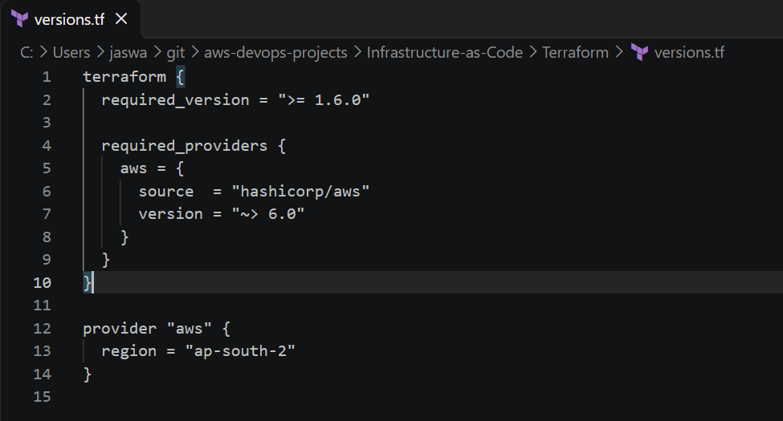
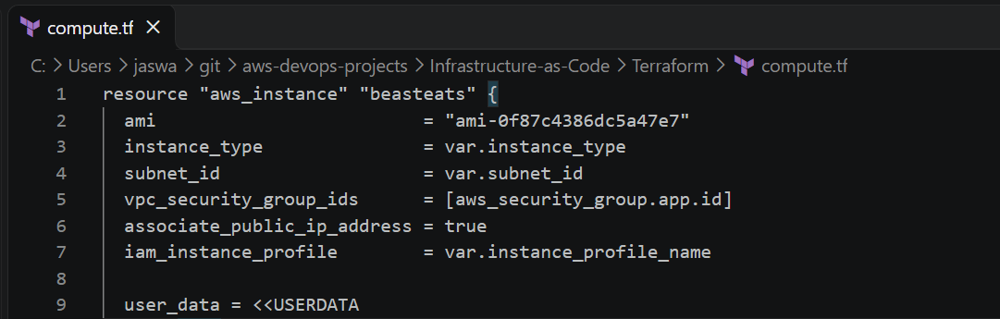
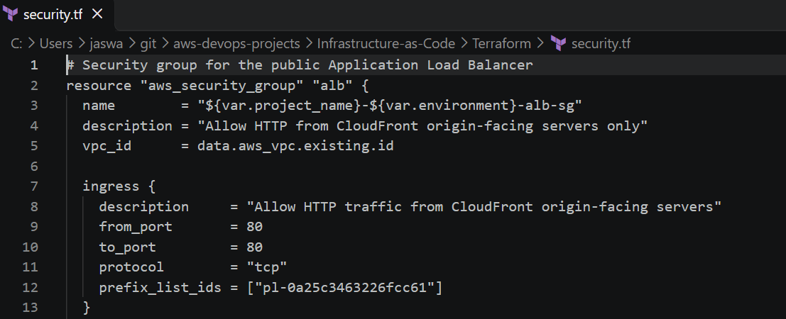
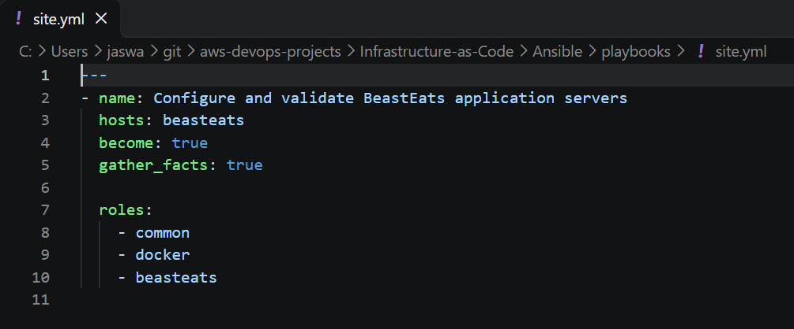
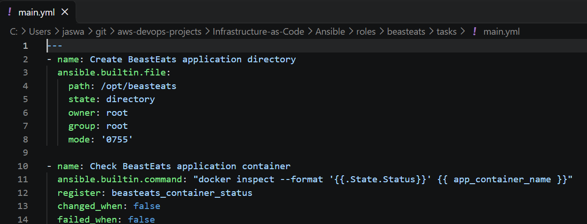
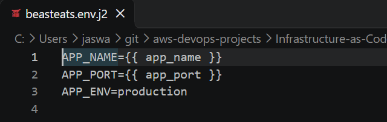

# Infrastructure as Code – Terraform & Ansible

This section showcases my hands-on practice with Infrastructure as Code (IaC), using **Terraform** to define AWS infrastructure and **Ansible** to automate application-server configuration for the BeastEats project.

## 1. Technologies Used

- Terraform
- AWS
- Ansible
- Amazon EC2
- AWS Security Groups
- YAML
- Linux

## 2. Repository Structure

```text
Infrastructure-as-Code/
├── assets/
│   ├── terraform-versions.png
│   ├── terraform-security-groups.png
│   ├── terraform-ec2-compute.png
│   ├── ansible-playbook.png
│   ├── ansible-beasteats-role.png
│   └── ansible-env-template.png
├── Ansible/
│   ├── ansible.cfg
│   ├── group_vars/
│   ├── inventory/
│   ├── playbooks/
│   └── roles/
└── Terraform/
    ├── environments/
    ├── versions.tf
    ├── variables.tf
    ├── data.tf
    ├── compute.tf
    ├── security.tf
    ├── storage.tf
    ├── loadbalancer.tf
    ├── cloudfront.tf
    └── outputs.tf
```

## 3. Terraform – AWS Infrastructure

Used Terraform with the HashiCorp AWS provider to define infrastructure for the BeastEats application in the AWS `ap-south-2` region.

### Terraform Configuration

- Configured the required Terraform version and AWS provider.
- Defined reusable input variables for project name, environment, AWS region and instance configuration.
- Used a sensitive variable for the CloudFront origin verification header.



### EC2 Compute Infrastructure

Defined an AWS EC2 instance configuration with:

- Configurable EC2 instance type.
- Existing VPC subnet and security group references.
- IAM instance profile association.
- Encrypted gp3 root volume.
- User-data bootstrap to install Docker.
- Persistent EBS data-volume mounting through a systemd service.



### Security Group Configuration

Defined separate security groups for the Application Load Balancer and application instance.

- ALB ingress allows HTTP traffic from the configured CloudFront origin-facing prefix list.
- ALB egress permits application traffic on port `8000` within the VPC.
- Application ingress permits port `8000` traffic from the ALB security group.
- Application egress supports required outbound connectivity.



## 4. Ansible – Configuration Management

Organized Ansible configuration into inventories, group variables, playbooks and reusable roles.

### Ansible Playbook

Created a playbook to configure and validate BeastEats application servers.

The playbook uses three roles:

- `common` – common server configuration.
- `docker` – Docker-related configuration.
- `beasteats` – BeastEats application configuration.



### BeastEats Ansible Role

Implemented tasks for the BeastEats application, including:

- Creating the application directory.
- Checking the application container status.
- Organizing application-specific configuration tasks.



### Environment Configuration Template

Used a Jinja2 template to generate application environment configuration dynamically.

The template includes:

- Application name.
- Application port.
- Application environment.



## 5. Key Learnings

- Defining AWS infrastructure using Terraform configuration files.
- Using Terraform variables and provider configuration.
- Configuring EC2 instances, storage and security groups.
- Understanding infrastructure dependencies and reusable configuration.
- Organizing Ansible inventories, playbooks and roles.
- Automating Linux application-server configuration.
- Using Jinja2 templates for environment-specific configuration.

---

**Project:** AWS DevOps Learning Portfolio
**Application:** BeastEats
**Section:** Infrastructure as Code – Terraform & Ansible