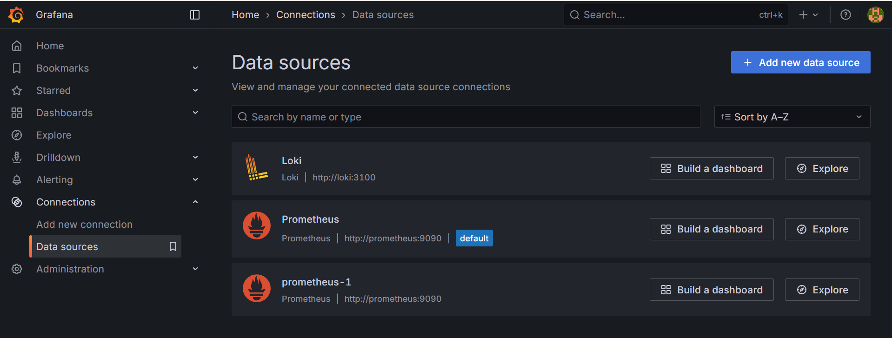
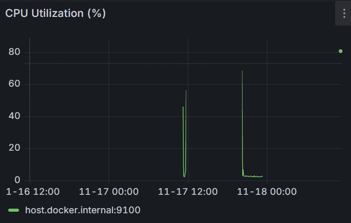
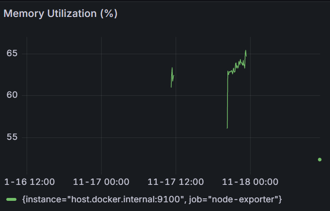
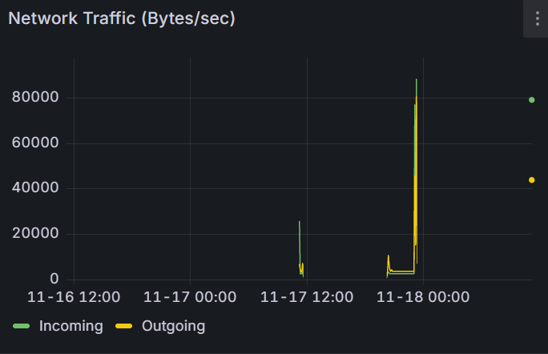
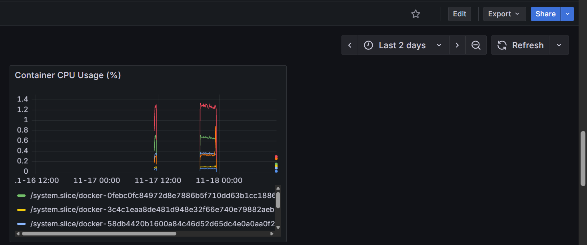
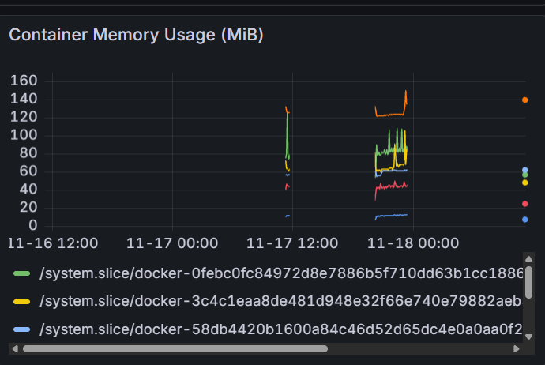
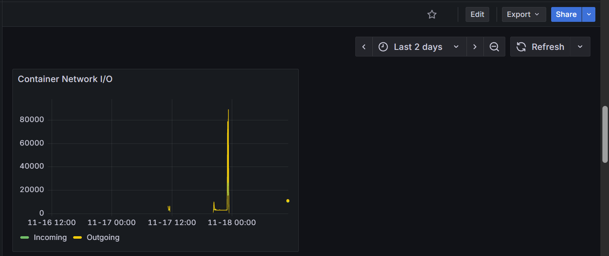

# Monitoring & Logging

This section documents the monitoring and logging setup explored for the **BeastEats** project using **Prometheus, Grafana, and Loki**.

The hands-on work focused on monitoring host and container resource utilization, visualizing infrastructure metrics, and configuring data sources for metrics and logs.

## Tools & Technologies

- **Prometheus** – Metrics collection and monitoring.
- **Grafana** – Dashboard creation and metrics visualization.
- **Loki** – Log aggregation and querying.
- **Docker** – Container environment used for monitoring.

## Hands-on Implementation

### 1. Grafana Data Source Configuration

Configured monitoring data sources in Grafana:

- Prometheus for metrics collection and querying.
- Loki for log aggregation and querying.

### 2. Infrastructure Monitoring

Created and explored monitoring visualizations for host-level resource utilization.

**CPU Utilization**

**Memory Utilization**

**Network Traffic**

### 3. Container Monitoring

Monitored Docker container resource utilization and network activity through Grafana dashboards.

**Container CPU Usage**

**Container Memory Usage**

**Container Network I/O**

## Key Learning Outcomes

- Configured Prometheus and Loki as Grafana data sources.
- Explored infrastructure monitoring dashboards.
- Observed CPU and memory utilization at the host level.
- Monitored container CPU, memory, and network activity.
- Practiced visualizing infrastructure metrics using Grafana.

---

**Project:** BeastEats
**Focus:** Infrastructure Monitoring & Logging
**Tools:** Prometheus | Grafana | Loki | Docker